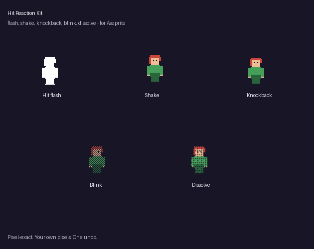

# Hit Reaction Kit Lite (free) for Aseprite

One click turns your sprite into a white hit flash: 2 new frames (flash, then the original), tagged `hit`.
Pixel-exact, palette-safe, one undo.

## Install
Double-click `hit-reaction-kit-lite.aseprite-extension`. Aseprite 1.3+.

## Use
Right-click the cel > Properties > **Hit Reaction Kit (Lite)...** or Edit > FX.

The full version adds flash colour, outline flash, 1-3 flash frames, shake, knockback, i-frame blink and a death dissolve, all five at once if you like:
https://mst-9.itch.io/hit-reaction-kit
**Disclosure:** the code was written with an AI coding assistant; no image AI is involved.

## Licence
MIT (this Lite version). The full version is a separate paid product.
